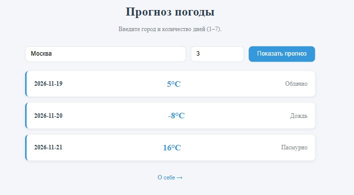
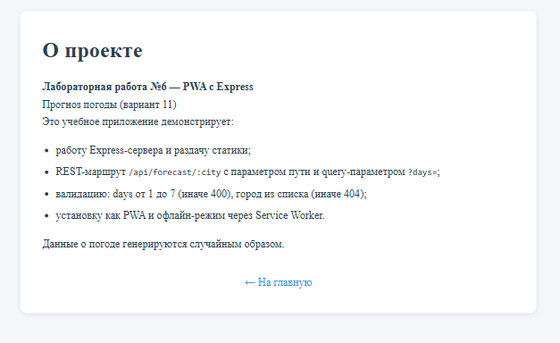
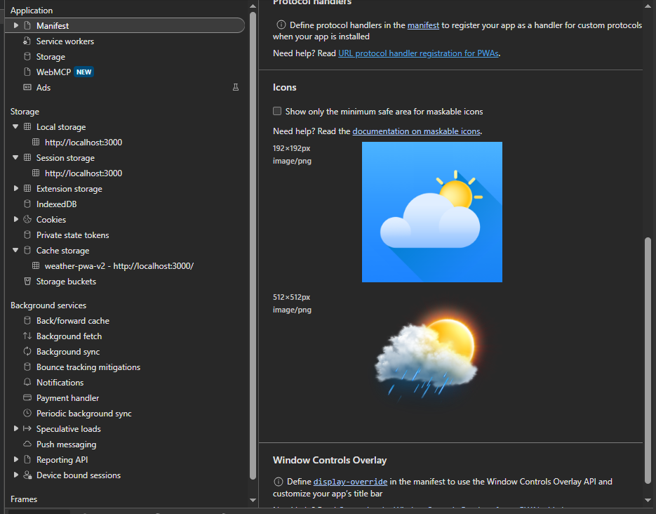
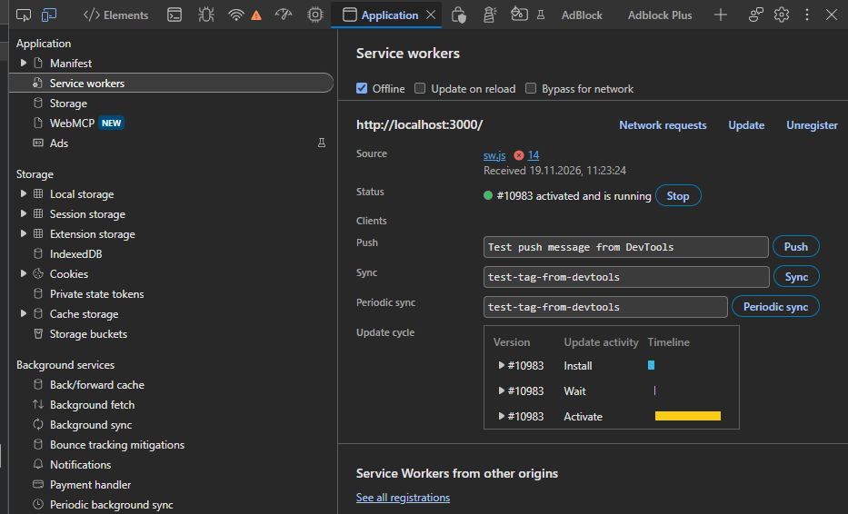

# Weather Forecast PWA (Лабораторная работа №6)

Учебное приложение для демонстрации работы Express-сервера, REST API и офлайн-режима через Service Worker. Прогноз погоды генерируется синтетически.

## Демонстрация работы приложения

### 1. Главная страница
Основной интерфейс для ввода города и количества дней прогноза.



### 2. Страница «О проекте»
Информация о лабораторной работе, маршрутах API и валидации данных.



### 3. Локальное хранилище в DevTools
Кешированные статические ресурсы и данные API в Application → Cache Storage.



### 4. Офлайн-режим
Работа приложения без подключения к сети: данные с прошлых серверов не подтягиваются и теперь корректно работает API при отсутствии данных в кэше.



## Технологии

- **Express.js** — сервер и раздача статики
- **REST API** — маршрут `/api/forecast/:city?days=` с валидацией параметров
- **Service Worker** — стратегия Network-first для API и Cache-first для статики
- **PWA** — манифест, иконки, установка на устройство

## Запуск проекта

```bash
npm install
npm start
